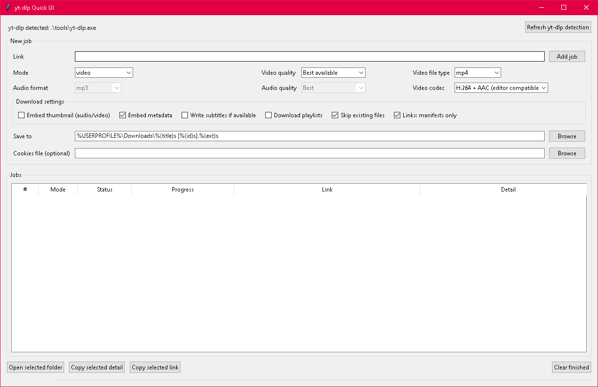

<div align="center">

# yt-dlp Quick UI

A Windows desktop interface for queuing yt-dlp video, audio, and direct-link jobs.

[](https://github.com/j117mw3/yt-dlp-quick-ui/releases/latest)
[](LICENSE)
[](#windows-downloads)

</div>



## Windows downloads

Choose the setup program for a guided per-user installation, or the portable
ZIP if you prefer to extract and run the app yourself. Both packages include
the app and its pinned download and media tools. Python is not needed for these
packages.

- **[Setup EXE](https://github.com/j117mw3/yt-dlp-quick-ui/releases/latest/download/yt-dlp-quick-ui-setup-v1.0.0.exe)** — adds Start menu shortcuts and offers an optional desktop shortcut.
- **[Portable ZIP](https://github.com/j117mw3/yt-dlp-quick-ui/releases/latest/download/yt-dlp-quick-ui-v1.0.0-portable.zip)** — extract the folder anywhere and run `yt-dlp Quick UI.exe`.
- **[Source ZIP](https://github.com/j117mw3/yt-dlp-quick-ui/releases/latest/download/yt-dlp-quick-ui-v1.0.0-source.zip)** — Python source and `run.bat` launcher.
- **[Third-party source ZIP](https://github.com/j117mw3/yt-dlp-quick-ui/releases/latest/download/yt-dlp-quick-ui-v1.0.0-third-party-source.zip)** — pinned source snapshots and build recipes for the bundled GPL/LGPL tools.

Use `SHA256SUMS.txt` from the same release to check downloaded assets. Read the
release notes and `THIRD_PARTY_NOTICES.md` for exact dependency versions and
license details.

## Features

- Queue video downloads with quality, container, and codec choices, including
  H.264 plus AAC for editor compatibility.
- Extract audio in MP3, M4A, AAC, Opus, Vorbis, FLAC, ALAC, or WAV formats.
- Inspect and copy direct media or manifest links.
- Select an output folder, optionally supply a cookies file, and choose whether
  to embed metadata or thumbnails, write subtitles, download playlists, and
  skip existing files.
- Follow each job's status, progress, speed, and ETA in the activity window.
- Open the output folder or copy a job's link and details.

## Run from source

Source execution requires Python 3.10 or newer with Tcl/Tk. `run.bat` prefers a
`.venv` beside the script, then the Python launcher, then `python.exe`. The
launcher does not install dependencies automatically.

You also need yt-dlp. You can place the official `yt-dlp.exe` beside the Python
file, install yt-dlp into the Python environment used by the app with
`python -m pip install -r requirements-source.txt`, or make yt-dlp available
on `PATH`. For full YouTube support, provide Deno as well; the Windows release
packages include it.

```powershell
py -3 -m venv .venv
.venv\Scripts\python.exe -m pip install -r requirements-source.txt
.\run.bat
```

FFmpeg is needed for merging separate video/audio streams and post-processing.
When supplied beside the app or on `PATH`, the app uses it automatically.

## Build Windows packages

Build dependencies are pinned in `requirements-build.txt` and
`tools/dependencies.json`. From a clean Windows x64 checkout with Python 3.12
and Inno Setup 6.7.1 installed:

```powershell
py -3.12 -m venv .build-venv
.build-venv\Scripts\python.exe -m pip install -r requirements-build.txt
.build-venv\Scripts\python.exe tools\build_release.py
```

The build downloads the exact versions in `tools/dependencies.json`, verifies
their SHA-256 checksums against upstream checksum files and pinned digests, and
builds the portable ZIP, setup EXE, source ZIP, third-party source ZIP, and
release checksum file. The same process runs on GitHub Actions for version
tags. Do not commit downloaded tools or generated packages.

## License and use

The GUI source is available under the MIT License. yt-dlp, FFmpeg, Deno, and
the build tools have separate licenses; see `THIRD_PARTY_NOTICES.md` and the
`licenses` folder in a Windows package. The GPL/LGPL media-tool source and
build recipe are provided in the release's third-party source archive.

Only download material you have the right to access and save. Respect the
source site's rules and the copyright holder's terms.

